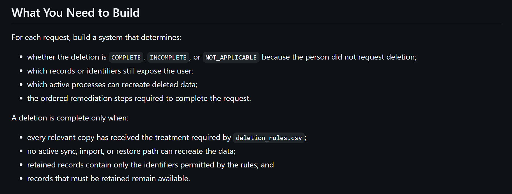
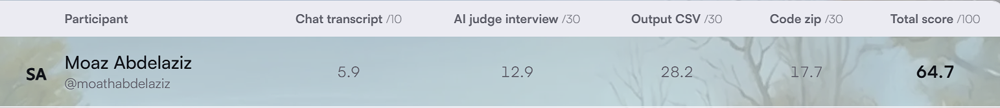

I took part in HackerRank Orchestrate (October 2026), a 24-hour hackathon where each participant builds an AI agent, submits the code and the AI chat transcript, and then defends the design in a 30-minute interview with an AI judge. My submission placed in the top 15%. 

This post is about how I worked more than what I built. The project is the example. The lessons are about deciding where a language model belongs, testing without an answer key, and directing AI coding tools without handing them the decisions. The code is public: [hackerrank-orchestrate-october26](https://github.com/Moath-COE/hackerrank-orchestrate-october26).

## The task

The challenge was called "Ghost Data Still Exists". A fictional shop reports a customer's deletion as complete, yet the customer's data survives in replicas, support attachments, search indexes, logs and backups. A sync job can even recreate data that was deleted.

The agent audits 518 deletion requests. For each one it returns `COMPLETE`, `INCOMPLETE` or `NOT_APPLICABLE`, plus an ordered list of findings, remediation steps and verification checks. The evidence came as PDFs, screenshots, logs, JSON and SQL snapshots. Output is graded against hidden answers, so I could not measure my progress on the real data.


## 1. Ask the AI to correct your understanding first

My first prompt to Claude Code was not a request to build anything. It was my own summary of the task, ending with "correct me and explain if I am wrong".

The reply confirmed the outline and fixed the part that mattered. The `reported_status` column is a claim from the existing workflow, not the truth, and the samples contained cases that were reported complete but were not. That one correction shaped the whole design (see lesson 3). It cost a few minutes and a short conversation, before any code existed.

## 2. Decide where the model goes, and keep it out of everything else

I started with the idea that a model was needed in one place: deciding whether a request really asks for deletion. The assistant checked the data and added a second place. Screenshots carry row-level facts that need vision, and OCR would lose the table structure.

Everything else turned out to be structured enough for ordinary code. The final pipeline looks like this:

```text
dataset/ ──► ingest ──► SQLite
                          ├─► classify requests   (LLM, batched, cached)
                          ├─► read PDFs and PNGs  (LLM, once per file, cached)
                          └─► per case: LangGraph workflow ──► output.csv
```

Only those two stages call a model. The full run made 35 calls and used about 153,000 tokens, which cost roughly USD 0.55 with Claude Sonnet 5.5. Each answer is cached under a key built from the input, the prompt and the model, so a rerun with warm caches makes no calls, and a cold run and a cached run produce byte-identical output.

The cost is a side effect. The main benefit is that I could defend every decision in the interview with "this is code, and here is the rule", except in the two places where I used a model on purpose.

## 3. Separate claims from evidence

This became the core idea of the agent. A workflow status, an activity-log row saying `DELETE_RECORD ... SUCCESS`, and the `reported_status` column are all claims. A snapshot row, a lookup that returns the record, or a document are evidence.

The agent builds one table of observations from every evidence file. Each observation records when the fact held, which copy it came from (primary, read replica, failover replica) and what state it showed. Each copy is judged separately at the case's `audit_at` time, so a stale replica row stays a finding even after the primary was cleaned.

The same principle applies to the model. When the model reads a PDF, the identifiers it extracts are checked literally against the PDF's text layer. A hallucinated value can then never link a document to a person.

## 4. Build your own test harness when the grader is hidden

The challenge gave 32 labelled samples and 518 unlabelled cases. I wrote three kinds of checks:

- A scorer for the samples with status accuracy, step precision and recall, and sequence match.
- Eight hand-built audit cases, each a small isolated world with hand-placed evidence and an answer written from the rules. Examples: replica drift, evidence captured after `audit_at`, and a repeat request from the same person.
- Six classifier cases, including requests in German and Spanish and the sentence "Please unsubscribe me from your newsletters. I am not asking you to delete my account."

To check that the custom cases could fail, I switched off a behaviour on purpose and confirmed the matching case broke. I did this for two behaviours.

The sample scores moved like this across the iterations:

| Step | Change | Recall | F1 | Exact sequence |
| --- | --- | ---: | ---: | ---: |
| 1 | Baseline: link by identifier | 0.767 | 0.865 | 0.281 |
| 4 | Attribute anonymous deletion-worker rows across cases | 0.927 | 0.952 | 0.594 |
| 6 | Learn the workflow's timing cadence per run, use it to rule candidates out | 0.974 | 0.987 | 0.844 |

Status accuracy was 32/32 from step 2 onward. The gains came from the harder question of finding records that carry no identifier at all, for example a deleted account that only appears as an anonymous row in the activity log.

## 5. Do not tune to the samples

Thirty-two samples are a small base, and there was a visible risk of fitting them too closely.

Two things in my workflow guarded against that. First, I used the public answer key only to measure how many expected resources my linking found, never to find them. The code does not read it. Second, the evaluation set differs from the samples: 100 of the 518 requests use a historical email address, against 3 of the 32 samples. A rule that works on the samples can fail there.

The evaluation report states the remaining risk plainly. Two heuristics, the rule for how listings outrank sightings and the cues for classifying support records, were inferred from a handful of sample cases. They are the most likely source of errors on new data. Also, 277 compliant verdicts in the evaluation set rest on a record being absent from a snapshot listing, which is an inference, not a direct observation.

## 6. Work with the AI in stages: understand, propose, direct, verify

I used Claude Code throughout, but not as a tool that takes a task and returns a solution. I kept the stages apart, and each had a different job for the assistant.

**Understand.** I used it first to understand the task, as described in lesson 1. When I got lost, I asked it to walk through a real sample case step by step, and later to explain the same process in simpler terms. Tracing real cases through the data taught me more than rereading the problem statement did.

**Propose.** Then I proposed the solution myself: LangGraph for the per-case flow, SQLite for fast lookups, and a model only where it was needed. We discussed it for a while before any code existed. The assistant agreed on SQLite and said LangGraph was optional for a near-linear flow. I wanted a vendor-neutral model layer, and that requirement tipped the choice to LangGraph with LangChain's model interface, where the provider is a `provider:model` setting. The discussion changed the design in several places, and the decisions stayed mine.

**Direct.** In the implementation stage, I gave the assistant one piece of work at a time and approved each one before the next: the project layout and schema first, then the loaders, the extraction step, the pipeline and the reports. I also set rules, such as keeping the caches out of git and not committing until I said so.

**Verify.** I did not take "it works" on trust. After each stage I ran the checks from lesson 4 and read the numbers. That caught the one change I rolled back. A first version of a rule treated every catalog entry as proof that a record was present. Running the evaluation set before and after showed it had changed citations in six cases and flipped two statuses, because rows logged minutes after a screenshot displaced that evidence. I narrowed the rule to "only when nothing else shows the record's state" before anything shipped.

The order is the point. Because I had the design and the tests before the code, I could tell when the assistant's work was wrong.

## What is still wrong

On the 32 samples the agent has status accuracy 1.000 and step precision 1.000, but step recall 0.974. All five missed steps are resources the agent did not find. Three of them appear nowhere in the data except the answer key. The other two are anonymous deletion-worker rows that more than one case could own, and I chose to leave them unassigned instead of guessing, because a wrong guess would add a false record to a case.

## The interview and the result

The interview was a 30-minute voice conversation with the AI judge, and it was deeply technical. It asked what I had built and why I chose that architecture, and I walked through the pipeline and the decisions behind each stage.

It also asked about my failures. I described the five missed steps and the rule I had to roll back, and the judge responded well to the honesty. That was the part I was most glad I had prepared, because the evaluation report already listed these problems in plain terms.

We talked about cost and how to reduce it. The run is cheap at about USD 0.55, so the discussion was about where the remaining spend goes and what would lower it.

I told the judge that I plan to try Jev, a decision model from TypeSafe AI. A general LLM writes text token by token, even when the task is only to pick one answer from a fixed set. Jev is built for that case: it scores the allowed answers and returns a choice, a score or a probability, without generating a reply. Request classification in this project is that kind of task, because every request maps to one of six intents. I expect it to lower the cost and also shorten the run, since classification makes up 20 of the 35 model calls and about 45% of the tokens in a full run. I have not measured the effect yet.

I am currently testing Jev in Becan, the AI tutor I built with my team, and I will write about the results in a separate post. [JEV docs](https://docs.typesafe.ai/introduction)

I also explained why I call the model through LangChain: the project is not tied to one provider, so the model can be swapped by changing a setting, and the code is easier to extend later.

Here is the score breakdown. My total was 64.7 out of 100, which placed in the top 15% in my first hackathon.



The output file scored highest, at 28.2 out of 30. The interview and the chat transcript scored lower, at 12.9 out of 30 and 5.9 out of 10. That is defiantly where I need to improve for the upcoming days to be more prepared to explain my work and defend my decisions. 

## Takeaway

The decisions that helped most were small and made early: question the task, use the model in two places only, treat claims and evidence differently, and write tests that can fail. The code and reports are in the [repository](https://github.com/Moath-COE/hackerrank-orchestrate-october26), including the evaluation report and the full session log.
