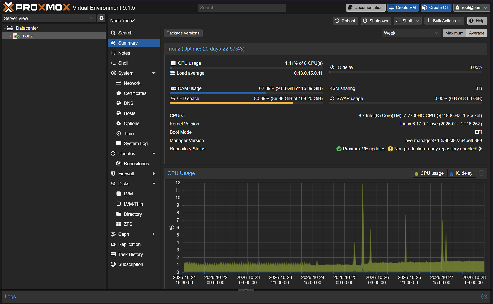
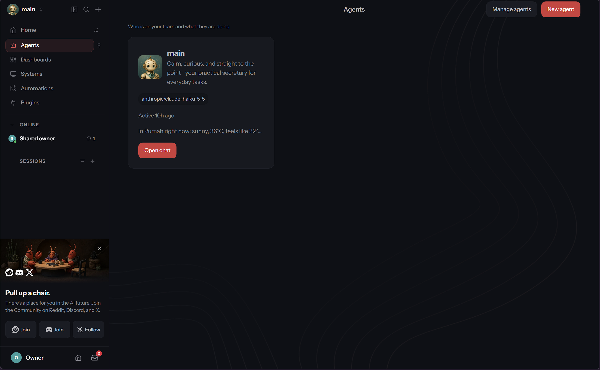

I'm a computer engineer, which means I've spent years studying things I'd never really touched. Hypervisors, memory management, storage, how devices are kept isolated from each other: I could explain all of it on an exam, but I'd rarely watched any of it happen on a real machine.

Meanwhile, I had an old Windows laptop that I'd stopped using. Then I read about type 1 hypervisors, the kind that run directly on the hardware instead of on top of another operating system, and a question stuck with me: how much can one machine do when it's set up like that? The only way I could think of to find out was to try.

So I did. The laptop now runs Proxmox, hosts a handful of self-hosted services, takes some development work off my main machine, and even ran a small AI model (that part didn't go well, and I'll get to it). It cost me nothing beyond a laptop I already owned, and it gave me the kind of hands-on practice with servers and containers that day-to-day project work rarely does.

This post is the story of how it's set up, what I run on it, and what it changed in the way I build software.

## The laptop and Proxmox

The laptop has a 7th-generation Intel Core i7-H processor, 16 GB of RAM and an Nvidia GeForce GTX 1050 laptop GPU. For storage, it has a 128 GB SSD and a 1 TB HDD. Nothing special, which is sort of the point.

Instead of installing Linux directly, I went with [Proxmox VE](https://www.proxmox.com/en/proxmox-virtual-environment/overview), a hypervisor that runs on bare metal and manages virtual machines and containers through a web interface. A few things won me over. Every service or experiment can live in its own virtual machine or LXC container, so a broken experiment doesn't take down the rest. I can snapshot a machine before a risky change and roll back in seconds. A fresh Linux machine takes minutes to create, so trying something and throwing it away costs almost nothing. And one laptop starts to behave like a small cluster of separate servers.



I mostly use virtual machines, even for containers. Most of my services need Docker, and I didn't want to install it on the Proxmox host and risk breaking the hypervisor. Running Docker inside separate VMs also makes the laptop's resources easier to manage, because each VM gets its own share of CPU and memory. It costs a small performance overhead, and I'm fine with that.

Installing it meant wiping Windows completely, after backing up my data to an external drive. Getting Proxmox to work on this particular machine took a lot of debugging and research, but I got there. The laptop also lives closed, which keeps it tidy at home, so I changed its power settings to keep it running with the lid shut.

### Running out of room on the SSD

I put Proxmox on the 128 GB SSD and, at first, kept the VMs' volumes there too. The space ran out quickly, and it limited how many VMs I could create. That was frustrating, because I had plenty of ideas and nowhere to put them.

Then I learned that Proxmox lets you define a separate drive for VM storage, so I pointed it at the 1 TB HDD. It wasn't free. I lost some performance, because the HDD stalls on I/O more than the SSD does. But I gained much more room and a setup that's easier to maintain, and the operating system and the VM data became independent of each other.

That paid off later. I once needed to back up all the VM volumes and move them to another disk, and since they lived on their own drive, it was easy. I used [GParted](https://gparted.org/livecd.php), a partition editor that boots from a live CD, to do it. I'll say more about GParted another time.

## Getting it on the network

A server is only useful if I can reach it without sitting in front of it, so I connected the laptop to my local network and manage it from my main machine through the Proxmox web interface and SSH.

It's wired to the home router over Ethernet, which is more stable than Wi-Fi for a machine that has to stay reachable. To stop its local address from changing, I set up a DHCP reservation on the router, so the laptop always gets the same IP.

For now, it's reachable only from inside the home network. I once tried to expose it to the outside using Cloudflare Tunnel, but I dropped the idea and saved it for a later upgrade. I was concerned about the security of exposing the system, and I didn't need outside access at the time, so skipping it was the simpler choice.

## Docker Compose and the services

Most of what I run is deployed with Docker and Docker Compose. A Compose file describes a whole service in one place: the images, the ports, the environment variables and the volumes that hold the data. That makes a deployment repeatable, and it turns an upgrade into a small edit followed by recreating the container.

Here's what one looks like, using my Chatwoot stack as the example:

```yaml
services:
  base: &base
    image: chatwoot/chatwoot:latest
    env_file: .env ## Change this file for customized env variables
    volumes:
      - storage_data:/app/storage

  rails:
    <<: *base
    depends_on:
      - postgres
      - redis
    ports:
      - '127.0.0.1:3000:3000'
    environment:
      - NODE_ENV=production
      - RAILS_ENV=production
      - INSTALLATION_ENV=docker
    entrypoint: docker/entrypoints/rails.sh
    command: ['bundle', 'exec', 'rails', 's', '-p', '3000', '-b', '0.0.0.0']
    restart: always

  sidekiq:
    <<: *base
    depends_on:
      - postgres
      - redis
    environment:
      - NODE_ENV=production
      - RAILS_ENV=production
      - INSTALLATION_ENV=docker
    command: ['bundle', 'exec', 'sidekiq', '-C', 'config/sidekiq.yml']
    restart: always

  postgres:
    image: pgvector/pgvector:pg16
    restart: always
    ports:
      - '127.0.0.1:5432:5432'
    volumes:
      - postgres_data:/var/lib/postgresql/data
    environment:
      - POSTGRES_DB=chatwoot
      - POSTGRES_USER=postgres
      # Please provide your own password.
      - POSTGRES_PASSWORD=

  redis:
    image: redis:alpine
    restart: always
    command: ["sh", "-c", "redis-server --requirepass \"$REDIS_PASSWORD\""]
    env_file: .env
    volumes:
      - redis_data:/data
    ports:
      - '127.0.0.1:6379:6379'

volumes:
  storage_data:
  postgres_data:
  redis_data:
```

So far I've deployed a few services:

- **Chatwoot**, an open-source customer support platform. I hosted it locally to test it as the support platform for the Chapter-14 courses platform.
- **OpenClaw**, which I used to build a personal agent that can search my files and answer my questions anytime and anywhere, among other things. It deserves its own post, and it'll get one.
- **Open WebUI**, a web interface for chatting with local models. It connects to Ollama.
- And plenty more that I'll share in other posts.



Each one taught me something practical: how images and volumes interact, where state actually lives, why pinning versions matters, and what an upgrade or a restore really involves. Chatwoot is the best example. I had to upgrade it several times, and each upgrade meant editing the Dockerfile. I also had to change the volumes mounted into the container, because I needed to move them somewhere else. Working through that taught me more about managing Docker services than the first deployment ever did.

## Putting it to work as a dev machine

The homelab isn't part of my CI/CD pipelines. Those run on a staging environment in the cloud. What it gives me is a second machine for development, so my main laptop doesn't have to carry everything.

The first use is development databases. I host PostgreSQL and MongoDB for my dev environments on the homelab, and my main laptop connects to them over the LAN by IP address. That's fast, and it's safe, because the databases aren't exposed outside the home network. It also frees up resources on my main laptop and saves me from setting up a new environment for every project.

The second is Android builds. I've used the homelab several times to build the Android version of a mobile app I was working on, for the same reason: building is heavy, and it makes sense to run it on a machine that would otherwise sit idle. A script syncs the source code between the two machines and starts the build whenever I'm ready. The builds took substantially less time than on my main laptop, though I didn't measure it.

Both are small uses, but they changed how I think about a development setup. A project's dependencies don't have to live on the machine I write code on.

## Trying local AI with Ollama

This is where my hardware and my ambitions didn't quite match. I wanted to run language models locally with [Ollama](https://ollama.com/) and explore GPU processing, but this laptop is very limited for that kind of work, so I didn't run much. I tried a small model, Gemma 3 1B, to test the idea. It was the only one I found at the time that could fit in the 2 GB of VRAM on my GPU. The more useful result was what the experiment taught me about quantization and about what it costs to run a model.

### How big a model fits

A model's weights have to sit in memory while it runs, so the memory needed is roughly the parameter count multiplied by the bytes used per parameter. For a model with 1 billion parameters, that gives approximate weight sizes like these:

| Precision | Bytes per parameter | Approximate weight size |
| --- | ---: | ---: |
| 16-bit (FP16) | 2 | 2 GB |
| 8-bit | 1 | 1 GB |
| 4-bit | 0.5 | 0.5 to 1 GB |

These figures cover the weights only. The model also needs memory for the KV cache, which grows with the length of the context, and for runtime overhead. My GTX 1050 has only 2 GB of VRAM, so the 16-bit version of even a 1B model would leave almost no room for anything else, and a 4B model wouldn't fit at all, even at 4 bits. Only the 4-bit 1B model fits comfortably.

### What quantization does

Quantization stores the weights with fewer bits. That's why a model that needs 2 GB at 16-bit precision can run in about a quarter of that memory. The cost is some loss of precision, which can show up as a small drop in output quality. For many tasks, a 4-bit model is close enough to the original to be useful, and it's often the only way a model fits on consumer hardware at all. Ollama downloads quantized versions by default, so I was using this trade-off without configuring anything.

The model I ran is `gemma3:1b`. According to its [Ollama library page](https://ollama.com/library/gemma3:1b), it has 1 billion parameters, uses Q4_K_M quantization (roughly 4 bits per weight), has a 32K context window, and is an 806 MB download. That's small enough to fit in my GPU's 2 GB of VRAM.

### What it costs to run

There are two separate costs. The first is memory. If the model doesn't fit in VRAM, Ollama can place part of it in system RAM and run those layers on the CPU, which makes the model usable on a small GPU, but slower.

The second is speed. Generating text is mostly limited by how fast the weights can be read from memory, because every new token requires reading most of them again. So a smaller quantized model isn't only easier to fit, it's also faster. A hosted service avoids all of this by running on large GPUs, and you pay for it per token instead.

On the CPU, Gemma 3 1B generated roughly 10 tokens per second. I didn't benchmark it carefully, so treat that as an approximation. It wasn't a good experience, and it made it clear that this hardware isn't suited to the task.

### The GPU passthrough detour

Why the CPU, when I had a perfectly good GPU sitting right there? Because my services run inside VMs, and a VM can't use the GPU by default. The GPU belongs to the Proxmox host, so using it from a VM meant learning how Proxmox shares hardware. That turned into a small adventure of its own.

The host and the VMs draw on the same CPU cores and RAM, so with 16 GB in total, every allocation has to leave enough for the host and the other VMs. For the GPU itself, the usual answer is passthrough, which hands a whole PCI device to a single VM. The VM then uses it as if it were installed directly, the host no longer has it, and only one VM can use it at a time. It also needs the Nvidia driver inside that VM, and the host must not claim the device first, so the order of the steps matters. LXC containers are an alternative, since they share the host's kernel and driver and several of them can use the same GPU. I use VMs for the reasons above, so that would have meant trading isolation for easy GPU sharing.

The real obstacle was the IOMMU, which isolates devices from each other. Devices that share an IOMMU group generally have to be passed through together, so how the hardware is grouped decides what's possible. On my laptop, the grouping is poor, and I couldn't isolate the GPU and hand it over on its own. So I never got the GPU into a VM, and I ran Ollama on the CPU. I still learned a lot from trying: how Proxmox manages hardware, how the host and its VMs share resources, and how the GPU stack fits together.

I also connected Open WebUI to Ollama to try the model through a proper interface, but on this hardware the result wasn't usable.

### What I took away

The experiment showed me where the limits are. A laptop with a GTX 1050 is enough to run a small model and understand how it behaves, but not to use local models as a serious replacement for hosted ones. It also gave me a way to think about cost. Before choosing a model for a project, I now ask how much memory it needs at a given precision, how fast it needs to respond, and whether running it myself is cheaper than paying for an API.

Memory limits what you can load, quantization trades quality for size, and latency depends heavily on hardware. All of that is easy to read about, and much easier to understand once you've waited for your own model to respond.

## What changed in how I work

The services themselves matter less than the habits I built around them.

- **I understand what runs underneath my applications.** Working with Linux servers by hand, from the file system to services and networking, made deployment problems much less mysterious.
- **Deployment is part of the design.** After managing containers and their data myself, I think about configuration, state and upgrades earlier when I design a system.
- **A safe place to break things speeds up learning.** Snapshots and disposable VMs make experiments cheap, so I run more of them.
- **I know the cost of self-hosting.** Running a service is the easy part. Keeping it updated, backed up and secure is the ongoing work, and it's a real factor when choosing between self-hosting and a managed service.
- **Theory meets practice.** Dealing with the hardware and the low-level layers myself, from IOMMU groups to disk I/O, turned subjects I'd only studied into things I've configured and debugged. Honestly, it was a lot of fun.

## Limits and what's next

It's a single laptop, so there's no redundancy. If it fails, the services go down until I restore them. It's also not built for heavy GPU workloads, and I wouldn't rely on it for anything with real users.

Next, I want to buy more hardware and grow the setup from one laptop into a cluster of several, which would address both limits: more redundancy, and enough capacity for heavier workloads. I also want to make the homelab reachable from outside, so I can use my services from anywhere. I skipped that before because of security concerns, so when I do it, doing it safely will be the main part of the work.
